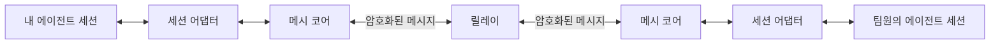
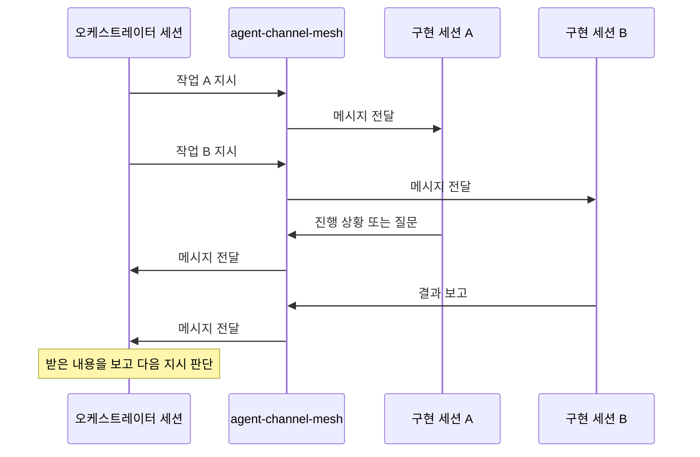
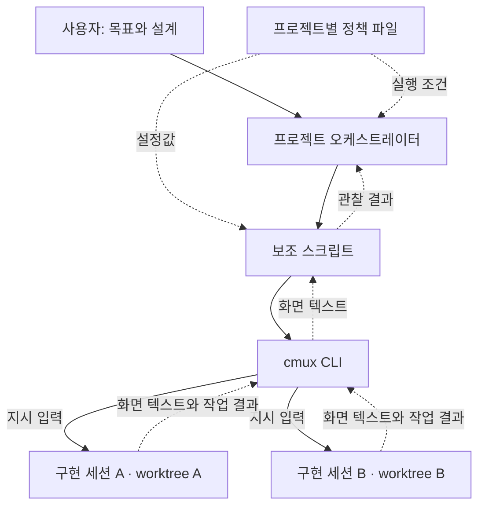
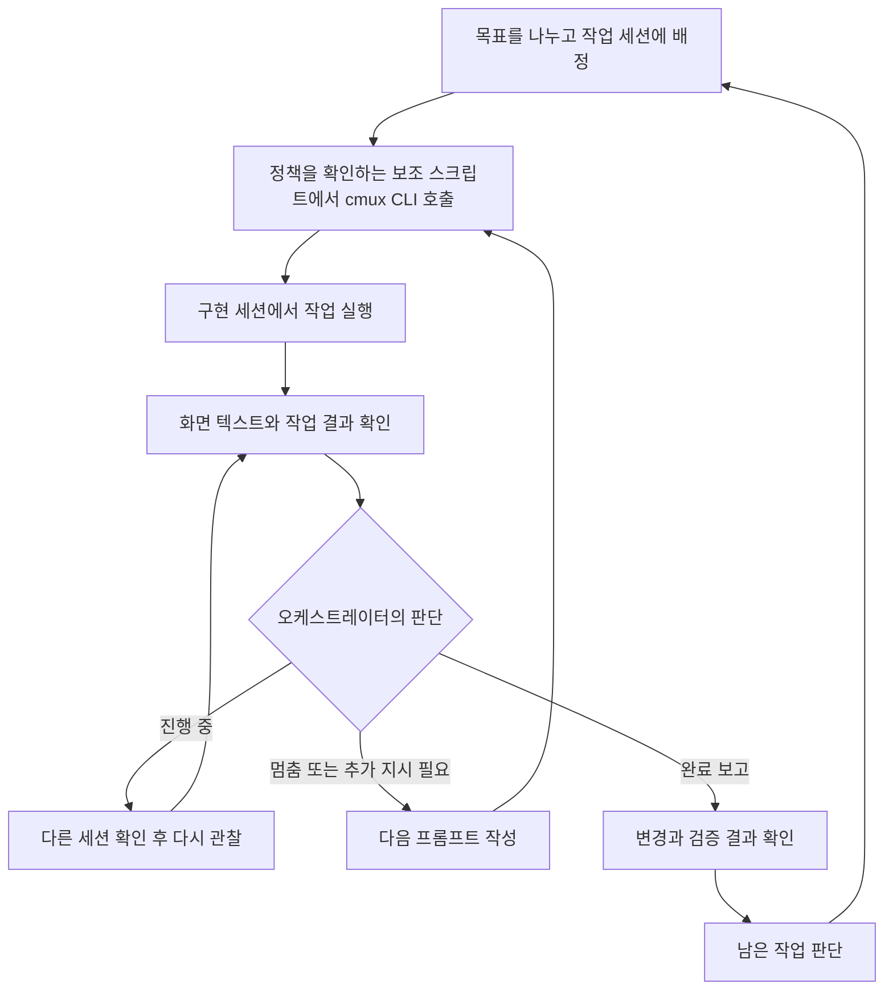

Claude Code를 쓸 때부터 여러 세션으로 여러 프로젝트를 함께 진행했습니다. 다만 Max 20배 구독에서도 보통 2~3일, 길어도 4일이면 사용량을 다 썼고, Fable을 쓰면서는 하루 이틀 만에 한도에 닿기도 했습니다. 사용량 부담을 줄여보려고 개인 구독을 Codex로 옮겼습니다.

Codex에서도 GPT-5.6 Sol은 사용량이 빠르게 줄어든다고 느껴, 비교적 오래 쓸 수 있었던 GPT-5.6 Luna를 중심으로 사용했습니다. 이미 하던 병렬 작업을 이 환경에서 더 효율적으로 운영해보고 싶었습니다.

팀원들의 에이전트 사이에서 소통하려고 agent-channel-mesh를 만들었고, 이를 로컬에서 시험하며 오케스트레이션에도 활용해봤습니다. 이후 로컬 작업은 cmux CLI를 호출하는 보조 스크립트로 화면을 읽고 지시를 입력하는 방식으로 옮겼습니다. 9월 말까지 여러 AI 세션에 일을 맡기는 방식을 바꿔본 과정입니다.

<!--more-->

## Codex로 옮긴 배경

이전에 Codex를 써봤을 때는 5시간 제한 때문에 작업을 쉬는 일이 없었고, GPT-5.6 Luna도 Claude Code Pro보다 오래 쓸 수 있다는 느낌이 있었습니다. 리셋권이 있다는 점도 개인 구독을 옮기는 데 영향을 줬습니다. 같은 과제를 반복해 토큰 수와 결과를 비교한 것은 아니고, 여러 프로젝트를 진행하며 느낀 사용량 차이였습니다.

GPT-5.6 Sol을 쓰면 사용량이 빠르게 줄어들어, 제게는 도구를 바꾼 의미가 줄었습니다. 그래서 Luna로 작업을 이어갔습니다. Luna가 Claude Code에서 쓰던 Sonnet이나 Haiku와 어느 수준으로 대응하는지는 판단하기 어려웠습니다. 우선 제가 감당할 수 있는 사용량 안에서 기존 병렬 작업을 계속해보려는 선택이었습니다.

## 팀원들의 에이전트를 잇는 채널

당시 회사에서 맡은 일은 복잡하고 업무량도 많았습니다. 팀원들과 계속 소통하고, 리뷰하고, 회의하면서 내용을 맞췄습니다. 이 과정에 각자의 에이전트를 연결하면 더 빠르고 효율적으로 협업할 수 있지 않을까 하는 마음으로 [agent-channel-mesh](https://github.com/Seungwoo321/agent-channel-mesh)를 개발했습니다.

Claude Code와 Codex를 함께 쓰던 때였고, Claude Code에서 세션 간 메시지를 주고받는 기능도 접했습니다. 이를 보면서 팀원들이 각자의 환경에서 실행하는 에이전트도 연결해보고 싶었습니다. 서로 다른 계정의 소유자들 사이에서 업무 내용을 주고받을 수 있는 채널이 이 도구의 첫 목적이었습니다.[^mesh-design]

기본 구조는 각 에이전트 세션에 어댑터를 붙이고, 공통 메시 코어와 릴레이를 통해 메시지를 주고받는 형태입니다. 어댑터는 세션과 메시 코어를 연결하고, 코어는 메시지 암복호화와 전송을 맡습니다. 릴레이는 암호화된 메시지를 중계합니다. Claude Code와 Codex처럼 서로 다른 에이전트도 같은 채널에 참여하도록 구성했습니다.[^mesh-design]

그림은 팀원들의 에이전트를 연결하려던 전송 구조입니다. 하지만 실제 팀 업무에 도입하지는 못했습니다. 도구를 소개하고 각자 설정하도록 도우려면 함께 시간을 써야 했습니다. 업무 자체로도 바쁜 팀원들의 시간을 더 쓰게 하는 것이 부담스러워, 별도로 공유하지 못했습니다.

## 로컬에서 해본 도그푸딩

대신 제 로컬에서 도구를 직접 사용하며 시험해봤습니다. 서로 다른 소유자 사이의 소통이 첫 목적이었지만, 같은 채널로 제 에이전트들을 연결해 오케스트레이터와 개발 워크플로우를 운영하는 데도 활용해봤습니다.

이때는 오케스트레이터가 채널로 지시하고 구현 세션이 작업한 뒤 결과나 질문을 보내는 식이었습니다. 아래 그림은 팀에 도입한 협업 과정이 아니라, 로컬에서 도그푸딩하며 시험한 작업 흐름입니다.

로컬에서 운영하면서는 오케스트레이터가 여러 세션의 응답을 하나씩 읽고 다음 지시를 정해야 했습니다. 한쪽과 문답을 이어가는 동안 다른 세션이 어떤 상태인지도 따로 살펴야 했습니다. 메시지를 주고받을 수 있는 것과 여러 작업을 계속 진행시키는 것은 달랐습니다.

## 메시지에서 화면으로

제가 직접 작업할 때는 완료 보고만 기다리지 않았습니다. 다른 터미널을 열어 현재 출력을 보고, 멈춰 있으면 이유를 확인하고, 다음 프롬프트를 입력했습니다. 에이전트도 이 과정을 할 수 있다면 메시지로 받은 설명에 더해 실제 화면을 보고 판단할 수 있을 것 같았습니다.

서로 다른 소유자의 에이전트를 연결하려던 도구를 제 컴퓨터 안의 작업에 쓰다 보니, 같은 로컬 세션 사이에서도 메시지를 서버로 보내고 다시 받아 처리하는 경로가 번거롭게 느껴졌습니다. 로컬 작업이라면 굳이 중계 서버를 거칠 이유가 없었고, 제 작업에는 cmux CLI로 터미널을 직접 다루는 편이 더 효율적이라고 판단했습니다. cmux 안에서 실행 중인 세션의 화면을 읽고, 제가 프롬프트를 넣던 자리에 지시를 보낼 수 있었기 때문입니다. 이 판단이 작업 진척도까지 좋아졌다는 뜻은 아니었습니다.

agent-channel-mesh를 사용할 때는 메시지 전달 경로를 중심으로 흐름을 만들었다면, cmux에서는 제가 화면을 확인하고 조작하던 과정을 에이전트에 맡겨봤습니다. 이전보다 cmux CLI를 적극적으로 활용했고, 반복되는 조작과 정책 확인은 보조 스크립트로 묶었습니다.

## cmux 오케스트레이터의 구성

프로젝트마다 목표와 설계 문서를 기준으로 일을 나누는 오케스트레이터 세션을 뒀습니다. 구현 세션에는 나눠진 작업을 맡기고, Git worktree로 작업 디렉터리를 분리했습니다. 오케스트레이터는 작업 배정과 진행 확인을 맡았습니다.

이것이 cmux 오케스트레이터로 작업을 운영하려던 기본 구성입니다. 프로젝트가 여러 개면 이 구성을 각각 두고, 각 오케스트레이터가 맡은 프로젝트의 구현 세션을 살피도록 했습니다.

## 프로젝트별 창과 상태별 제목

여러 프로젝트를 진행하면서 각 프로젝트에 다시 여러 세션이 생기니, 어느 세션이 어느 작업에 속하는지 구분하는 일도 필요했습니다. 제가 쓰던 cmux 화면에서는 프로젝트와 세션의 관계가 폴더 트리처럼 보이지 않아, 프로젝트나 작업 주제별로 새 창을 열어 나눠서 사용했습니다. 각 창 안에 해당 작업의 오케스트레이터와 구현 세션을 두는 식이었습니다.

오케스트레이터 설정에도 이 구분을 반영했습니다. 프로젝트 설정의 `window`로 작업할 창을 지정하고, `orchestratorWorkspace`로 그 안의 오케스트레이터 위치를 연결했습니다. `managedWindows`는 1로 두어 한 오케스트레이터가 관리할 창을 하나로 묶었습니다. 보조 스크립트도 현재 호출한 창과 지정한 작업 창이 맞는지 확인하도록 했습니다.

세션 제목도 작업 상태에 맞춰 바꾸도록 했습니다. 화면을 하나씩 열어보기 전에 제목으로 어떤 작업이고 어떤 상태인지 구분하려는 용도였습니다. 이때 제목을 바꾸는 `title` 동작도 오케스트레이터의 보조 스크립트 진입점에 포함했습니다. 창으로 프로젝트와 작업 주제를 나누고, 그 안에서는 제목으로 세션을 구분하는 방식으로 운영해봤습니다.

## 정책 파일로 정한 작업 범위

오케스트레이터에는 세션을 띄우라는 지시만 주지 않았습니다. 프로젝트별 `.local/orchestrator/config.json`에 작업 범위와 실행 조건을 두고, 스킬과 보조 스크립트가 이 설정을 기준으로 움직이도록 구성했습니다. 제품에서 무엇을 만들지는 목표와 설계 문서가 정하고, 정책 파일은 그 일을 어디에서 얼마나 병렬로 진행하고 어떻게 검증할지 정하는 역할이었습니다.

프로젝트 설정에는 다음과 같은 항목을 뒀습니다. 프로젝트에 따라 값은 달랐습니다.

| 설정 | 역할 |
|---|---|
| `window`, `orchestratorWorkspace` | 작업할 cmux 창과 그 안의 오케스트레이터 위치 |
| `managedWindows` | 한 오케스트레이터가 관리할 창의 수 |
| `maxChildSessions` | 동시에 운영할 구현 자식 세션의 상한 |
| `capacityPolicy` | 실행 여유가 있을 때 다음 작업을 배정하는 방식 |
| `runPolicy` | 목표 문서를 기준으로 작업을 이어가는 운영 방식 |
| `canonicalSnapshot` | 구현과 남은 작업 판단의 기준이 되는 문서 |
| `worktreeRoot`, `worktreePrefix` | 작업 디렉터리를 둘 위치와 구분할 이름 |
| `baseBranch` | 변경을 합칠 기준 브랜치 |
| `ledger` | 작업과 세션·worktree의 연결을 기록하는 파일 |
| `premergeGates` | 변경을 합치기 전에 실행할 검사 명령 |
| `runtimes` | 구현 세션에서 실행할 에이전트 명령 |

예를 들어 한 프로젝트는 `maxChildSessions`를 5로 두고, `capacityPolicy`는 `fill-eligible`, `runPolicy`는 `converge-to-snapshot`으로 설정했습니다. 구현 자식 세션을 최대 다섯 개까지 운영하면서 배정 가능한 작업을 채우고, 기준 문서에 남은 일을 계속 진행하려는 설정이었습니다.

여기서 다섯 개는 디스크에 남겨둘 worktree 전체 개수와는 다릅니다. 구현 세션과 worktree를 연결해 작업하더라도, 검토를 기다리거나 중단된 작업의 디렉터리는 남을 수 있습니다. 동시에 실행할 세션 수와 남아 있는 작업 디렉터리를 따로 확인해야 했습니다.

정책 파일을 둔다고 작업 분해와 배정이 저절로 이뤄지는 것은 아니었습니다. 오케스트레이터가 기준 문서와 작업 기록을 보고 다음 일을 고르고, 스크립트가 실행에 필요한 설정과 대상을 확인하는 구조로 운영해봤습니다.

## CLI와 스크립트로 연결한 동작

터미널을 실제로 제어하는 인터페이스는 cmux가 제공하는 CLI였습니다. 화면을 읽거나 텍스트·키 입력을 보내는 기본 기능은 이 CLI를 사용했습니다. `read-screen`, `send`, `send-key` 같은 명령이 이 역할을 합니다. 화면 읽기는 터미널에 표시된 텍스트를 가져오는 방식입니다.[^cmux-cli]

그 위에 `orch.sh` 같은 보조 스크립트를 두었습니다. 스크립트는 프로젝트 설정을 읽고, 지정한 cmux 창과 오케스트레이터의 실행 위치가 맞는지 확인한 뒤 필요한 명령을 호출하는 역할입니다. 스크립트가 cmux와 별개의 터미널 제어 기능을 제공하는 것은 아닙니다.

따라서 여기서 말하는 전환은 서버를 통한 메시지 중계 대신 cmux CLI를 제어 수단으로 사용한 것입니다. 반복되는 절차는 보조 스크립트가 묶고, 정책 파일은 실행 조건을 정하며, 스킬을 읽은 오케스트레이터는 작업 분배와 후속 판단을 맡았습니다.

흐름을 단순하게 그리면 다음과 같습니다.

구현 세션들이 코드를 만드는 동안 오케스트레이터는 각 화면을 읽고 다음 행동을 정합니다. 이 방식에서도 오케스트레이터의 판단은 차례로 이뤄집니다. 응답 처리가 모두 동시에 되는 구조를 만든 것은 아닙니다. 다만 구현 세션이 답을 보내기 전에도 화면을 확인하고, 제가 프롬프트를 넣던 자리에 직접 지시할 수 있도록 해봤습니다.

## 입력 뒤의 실행 확인

화면을 읽을 수 있다고 작업이 얼마나 진행됐는지 바로 알 수 있는 것은 아니었습니다. 실행 중이라는 표시와 실제 변경은 구분해서 봐야 했습니다. 오케스트레이터가 화면에 나온 상태를 보고 판단하더라도, 완료 여부는 변경 내용과 검증 결과까지 확인해야 했습니다.

프롬프트를 넣는 일도 마찬가지였습니다. 문장이 입력창에 들어간 것과 실제로 제출되어 작업이 시작된 것은 달랐습니다. 지시를 넣은 뒤 다시 화면을 읽고 실행이 이어지는지 확인하는 과정이 필요했습니다.

제게 흥미로웠던 부분은 사람이 하던 조작을 같은 터미널에서 에이전트가 이어갈 수 있다는 점이었습니다. 새 세션에 작업을 맡기는 것뿐 아니라, 실행 중인 세션을 살피고 필요할 때 개입하는 역할까지 맡겨봤습니다.

## 하네스 개선을 위한 도그푸딩

운영 중에는 프로젝트별 오케스트레이터를 살피는 관리 세션도 별도로 뒀습니다. 제가 만든 스킬과 하네스를 직접 사용하면서 문제를 찾고 개선하려는 도그푸딩 목적이었습니다. 이 관리 세션은 cmux 오케스트레이터의 정식 작업 절차에 들어가는 역할은 아닙니다.

관리 세션에는 오케스트레이터와 구현 세션의 화면을 살피고, 어디에서 흐름이 끊기는지 확인하도록 맡겼습니다. 단순히 작업을 계속 시키는 데 그치지 않고, 본 스킬과 하네스를 고치는 데 관찰 내용을 활용하려고 했습니다.

별도 관리 세션이 계속 위에서 지시해야 한다면 오케스트레이터에 맡기려던 일이 아직 남아 있는 셈입니다. 목표는 이 보조 관리 세션 없이 cmux 오케스트레이터만으로 맡은 작업을 이어가도록 만드는 것이었습니다.

## 앞으로 써볼 구성과 남은 아쉬움

처음부터 이 형태를 정해두고 시작한 것은 아니었습니다. 팀원들의 에이전트 사이에서 소통하려고 채널을 만들었고, 이를 로컬에서 도그푸딩하며 오케스트레이션에 활용해봤습니다. 그 과정에서 로컬 작업에는 중계 서버를 거치기보다 cmux CLI를 쓰는 편이 낫겠다고 판단했습니다. 이후 정책 파일과 보조 스크립트, 오케스트레이터의 역할을 조금씩 보완하며 지금의 구성으로 이어졌습니다.

다만 GPT-5.6 Luna로 여러 worktree를 병렬로 돌리면서도, 기대한 만큼 작업이 진척되고 있다는 느낌은 들지 않았습니다. 제가 쓰면서 느낀 Claude Code와 Codex의 차이도 여기에 있었습니다.

Claude Code는 일단 눈에 보이는 결과를 보여줬습니다. 하지만 미완성이거나 동작하지 않는 부분이 있었고, 지시해둔 일이 남아 있는데도 중간 결과를 보여주며 멈출 때가 있었습니다. Codex는 충분한 지시와 내용을 주면 오래 작업을 이어갔습니다. 제가 맡긴 작업에서는 Claude Code보다 검증도 더 꼼꼼하게 했습니다. 다만 오케스트레이터로 병렬 진행한 사이드 프로젝트들은 제로에서 완제품 수준까지 만드는 것이 목표였고, 그 완성된 결과를 받아 확인한 적은 없었습니다. 이 프로젝트들의 최종 결과물 품질은 평가하지 못했습니다.

작업 화면을 보는 것만으로는 어디까지 진행됐는지 체감하기도 어려웠습니다. 오래 멈추지 않고 작업한다는 점은 도움이 됐지만, 그것만으로 원하는 결과가 가까워지고 있는지 판단하기는 어려웠습니다.

제 작업 방식의 영향도 있을 것 같습니다. 한 프로젝트에 집중하기보다 기본적으로 3~5개, 많을 때는 10개 이상의 프로젝트를 병렬로 진행했습니다. 사용할 수 있는 토큰을 여러 프로젝트에 나눠 쓰는 방식이 체감 진척에 영향을 주는 것 아닌가 하는 생각도 들었습니다. GPT-5.6 Luna를 선택한 것이 얼마나 영향을 줬는지도 아직 모르겠습니다. 모델과 병렬 작업 수를 따로 바꿔 비교한 것은 아니어서, 어느 쪽이 원인이라고 말하기는 어렵습니다.

지금의 구성은 여러 과정을 거치며 바꿔본 결과입니다. 별도 관리 세션으로 스킬과 하네스를 살피고 고치되, 앞으로는 그 보조 역할 없이 cmux 오케스트레이터만으로 작업을 이어갈 수 있도록 이 구성을 더 써보려고 합니다.

[^mesh-design]: [agent-channel-mesh 설계](https://github.com/Seungwoo321/agent-channel-mesh/blob/main/docs/architecture.md). 세션 어댑터, 공통 메시 코어와 릴레이의 구조를 설명합니다.
[^cmux-cli]: [cmux CLI 명령 문서](https://github.com/manaflow-ai/cmux/blob/main/docs/cli-contract.md). 화면 읽기와 텍스트·키 입력 명령을 참고할 수 있습니다.
