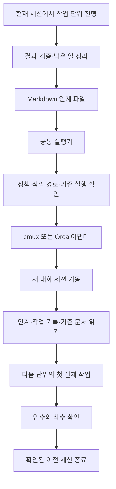
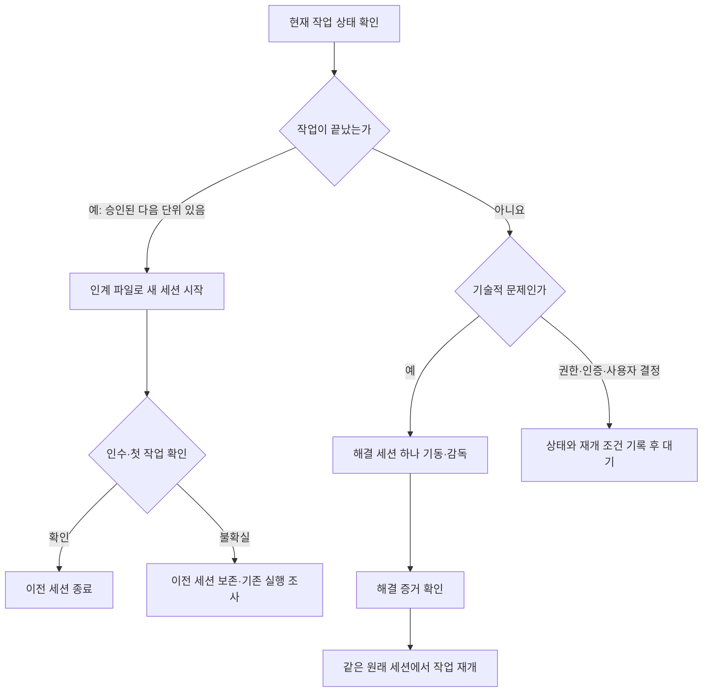

9월에는 GPT-5.6 Luna의 사용량 여유를 이용해 여러 구현 세션을 병렬로 돌리고, cmux 오케스트레이터가 각 세션의 화면을 살피며 지시하도록 구성해봤습니다.

간단한 단건 작업에서는 Luna도 그럭저럭 괜찮았습니다. 하지만 복잡한 리팩터링·마이그레이션에서는 기능 누락을 봤고, 제로에서 완제품을 목표로 병렬 진행한 사이드 프로젝트들은 완성된 결과를 확인하지 못했습니다.

그래서 지금은 병렬 작업 수를 줄이고 GPT-6.1 Sol 같은 최신 프론티어 모델을 쓰면서, 작업 단위마다 새 세션으로 시작하는 방식을 시도하고 있습니다. 늘어난 글로벌 규칙도 줄였습니다. 이번에는 제가 바꾼 입력과 작업 인계 방식을 정리해보려고 합니다.

<!--more-->

## 오래 돌아가는 세션과 확인하지 못한 결과

Claude Code를 사용할 때는 주기적으로 상태를 확인하고 다음 지시를 주는 오케스트레이터 역할이 제 작업에 맞았습니다. 크론이나 스케줄로 프롬프트를 반복 실행하며 다른 세션을 살피는 방식과도 잘 맞는다고 봤습니다.[^schedule]

Codex는 충분한 지시와 내용을 주면 자체적으로도 오래 작업을 이어갔습니다. 여기에 여러 구현 세션을 더 띄웠지만, 제가 기대한 만큼 작업이 진척되는지는 알기 어려웠습니다. 작업 화면에서는 개발과 검증을 계속하는 모습이 보였고, 제가 맡긴 작업에서는 Claude Code보다 검증도 더 꼼꼼하게 했습니다.

Luna로 간단한 작업을 하나씩 처리할 때는 그럭저럭 괜찮았습니다. 반면 기존 코드의 기능은 유지하면서 구조나 형식을 바꿔 옮기는 복잡한 리팩터링·마이그레이션에서는 누락된 기능이 많았습니다. 이쪽은 기존 기능이 빠진 것을 실제로 확인한 경험입니다.

오케스트레이터로 병렬 진행한 사이드 프로젝트들은 목표가 달랐습니다. 기존 코드의 일부를 고치는 것이 아니라, 제로에서 완제품 수준까지 만드는 프로젝트들이었습니다. 이 프로젝트들은 완성된 구현 결과를 본 적이 없어 최종 품질을 검증하지 못했습니다. 단건 작업이나 마이그레이션에서 본 결과와 이 미확인 상태를 같은 평가로 묶을 수는 없었습니다.

그래서 실행 규모를 계속 키우기보다, 동시에 맡기는 수를 줄이고 더 강한 모델을 써보는 쪽으로 바꿨습니다. 복잡한 작업에서 누락을 겪었고, 새 프로젝트들이 오래 실행되는 동안에도 완제품을 확인하지 못한 상황이 이 선택의 배경이었습니다.

## 길어진 입력을 줄이기

제 작업 방식도 돌아봤습니다. 하나의 세션에서 아주 오래 작업을 이어가다 보니, 앞에서 쌓인 대화와 규칙을 계속 들고 가는 형태였습니다. 캐시로 처리되는 입력까지 포함해 긴 문맥을 반복해서 사용하는 부담이 크다고 판단했습니다.

캐시를 쓰는 것이 문제라는 뜻은 아닙니다. 캐시는 반복 입력의 처리 비용을 줄이기 위한 기능입니다.[^cache] 다만 제 경우에는 캐시를 활용하더라도 계속 들고 가는 입력 자체를 줄여볼 필요가 있다고 봤습니다. 실제 구독 사용량에서 긴 문맥이 차지한 비용을 따로 측정한 것은 아니어서, 원인을 확정하거나 절감률을 말할 수는 없습니다.

먼저 매번 공통으로 들어가는 글로벌 규칙을 정리했습니다. 10월 23일 백업과 현재 파일을 비교하면, Codex에 사용하는 글로벌 규칙 문서는 53,665자에서 7,755자로 줄었습니다. 문자 수 기준 약 85.5% 줄어든 크기입니다.

이는 토큰 수나 실제 비용이 같은 비율로 줄었다는 뜻은 아닙니다. 다만 모든 작업에 공통으로 붙이던 텍스트의 양을 줄인 것은 확인할 수 있었습니다. 여기에 한 세션을 계속 연장하는 대신, 작업에 필요한 문맥으로 다음 세션을 시작하는 방식을 함께 적용하고 있습니다.

## 작업 단위와 세션의 경계

이전에는 한 세션을 오래 유지하면서 계획의 다음 일을 계속 이어가도록 했습니다. 지금은 작업 계획에서 한 단위가 끝나는 지점을 세션을 바꾸는 시점으로 삼으려 합니다. 대화가 길어져 압축이 필요한 때까지 기다리기보다, 작업의 경계에 맞춰 필요한 정보를 다음 세션에 넘기는 방식입니다.

예전 Claude Code의 컨텍스트가 200k일 때는 자동 압축 뒤 작업 맥락이 제대로 이어지지 않는 문제를 겪었습니다. SDI와 Clawket 같은 작업 기록을 두고 세션 시작 시 필요한 내용을 주입한 것도 일을 이어가기 위해서였습니다. 컨텍스트가 1M으로 늘어난 뒤에는 그 방식에 덜 의존하게 됐지만, 이제는 긴 대화를 유지하는 것 자체를 다시 줄여보려는 것입니다.

현재는 Markdown 인계 파일을 사용합니다. 여기에는 전체 대화를 복사하지 않고 목표, 확정한 결정, 변경 파일, 검증 결과, 남은 일과 다음 단위의 첫 행동을 짧게 남깁니다. 다음 세션이 무엇을 이어받아야 하는지 설명하는 입력입니다.

이 전환을 맡긴 것이 세션 핸드오프 스킬과 실행 도구입니다. 스킬에는 언제 넘기고 무엇을 전달할지에 대한 규칙을 두고, 실행 도구에는 실제 세션 기동과 인수·착수 확인을 맡겼습니다. 오늘부터 실제 작업에 적용하고 있는 구성입니다.

새 세션을 연다는 것은 지금 작업을 처음부터 다시 설명한다는 뜻이 아닙니다. 끝난 일과 다음에 할 일을 정리하고, 새 대화가 그 지점에서 시작하도록 하는 것입니다. 코드가 있는 작업 공간과 작업의 연속성은 유지하면서, 대화의 문맥을 새로 시작하려는 선택입니다.

## 인계 파일 다음에 필요한 확인

인계 파일만 만들고 끝내면 제가 다시 새 세션을 열어 내용을 전달해야 합니다. 현재 구성에서는 공통 실행기가 정책과 작업 경로, 이미 실행 중인 후속 세션이 있는지 확인하고, 선택한 환경의 어댑터를 통해 새 세션을 기동하도록 했습니다. 기동 과정에서 원래 작업의 권한을 넓히지는 않습니다.

새 창이나 입력 접수 기록만으로 인계를 완료하지도 않습니다. 새 세션이 인계 내용을 받아들였는지, 첫 작업을 실제로 시작했는지 확인한 뒤 이전 세션을 닫도록 했습니다. 입력창에 프롬프트가 남아 있거나 실행 여부가 불확실하면 기존 세션을 보존하고, 같은 일을 중복 기동하지 않도록 합니다.

| 구성 | 현재 맡긴 역할 |
|---|---|
| 핸드오프 스킬 | 작업 단위의 경계와 전달할 내용 정의 |
| Markdown 인계 파일 | 목표·결정·검증·남은 일·다음 행동 전달 |
| 작업 기록·기준 문서 | 새 세션에서 현재 범위와 상태 재확인 |
| 실행 정책 | 작업 경로·실행 프로필·기존 권한 유지 |
| 공통 실행기 | 중복 실행과 대상 확인, 기동·인수·착수 상태 관리 |
| cmux·Orca 어댑터 | 각 환경의 세션 생성·화면 읽기·입력·정확한 종료 연결 |

세션을 바꾸는 것과 작업 디렉터리를 새로 만드는 것도 구분했습니다. 같은 작업 공간에서 대화만 새로 시작할 수 있고, 코드 변경을 격리할 필요가 있을 때는 worktree를 사용할 수 있습니다. 세션 핸드오프 자체는 worktree에 의존하지 않습니다.

## 막혔을 때 이어가는 방식

현재 작업이 끝났을 때 다음 단위로 넘기는 것과, 진행 중인 작업이 기술적인 문제로 막힌 것은 다르게 처리하도록 했습니다. 기술 블로커에서는 원래 세션이 해결 세션 하나를 띄워 감독하고, 해결됐다는 근거를 확인한 뒤 같은 세션에서 원래 일을 재개하는 경로를 뒀습니다.

해결 세션이 다시 해결 세션을 계속 늘리지 않도록 깊이를 한 단계로 제한하고, 같은 원인은 최대 두 번까지 시도하도록 했습니다. 권한이나 인증, 제가 결정해야 할 사항은 이 경로로 대신 해결하지 않습니다. 다음 대화로 옮겼다는 이유로 막힌 일이 해결된 것처럼 처리하지 않으려는 규칙입니다.

## 지금 적용하는 작업 환경

작업 화면은 최근 Orca로 옮겨봤습니다. cmux도 꽤 써봤으니 다른 도구도 써보고 싶었고, 좌측 사이드바의 프로젝트 폴더 트리 안에서 작업 공간과 여러 세션을 보는 구성이 제 작업 방식에 맞아 보였습니다. 한눈에 복잡한 상태가 다 보이니 여전히 복잡하기도 합니다.

지금 바꿔보는 것은 화면 하나가 아닙니다. 동시에 맡기는 작업 수를 줄이고, 최신 모델을 쓰고, 공통 입력을 줄이고, 계획의 작업 단위가 끝날 때 새 세션으로 넘기는 구성을 함께 사용하고 있습니다.

이 변화로 실제 비용이 줄었거나 작업 진척이 나아졌다는 결과는 아직 없습니다. 지금은 오래 계속 돌리는 방식을 유지하는 대신, 한 단위에서 무엇을 끝냈고 다음 세션이 어디서 시작하는지를 확인하면서 사용해보려 합니다.

[^schedule]: [Claude Code 예약 작업 문서](https://code.claude.com/docs/en/scheduled-tasks)는 세션 안에서 프롬프트를 반복 실행하는 `/loop`와 크론 도구를 설명합니다. 여기서는 이를 관리 역할에 활용할 수 있다고 본 제 작업 방식을 이야기합니다.
[^cache]: [OpenAI API의 프롬프트 캐시 설명](https://developers.openai.com/api/docs/guides/prompt-caching). API의 캐시 처리 설명이며 제 구독 사용량의 차감이나 이번 변경의 실제 절감 효과를 측정한 자료는 아닙니다.
